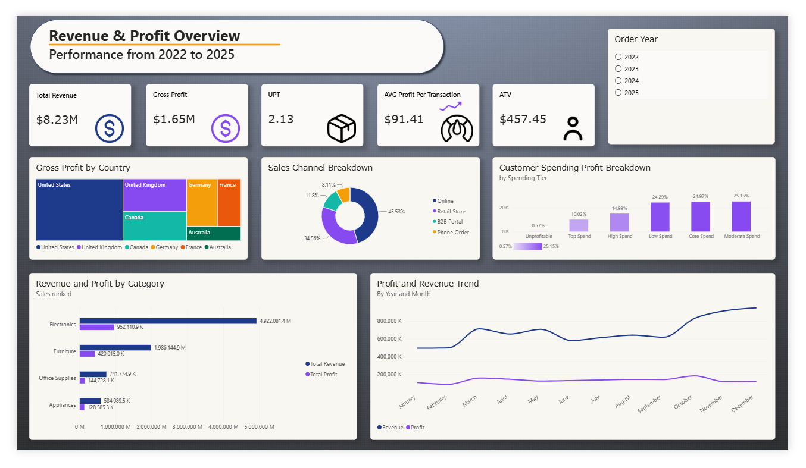
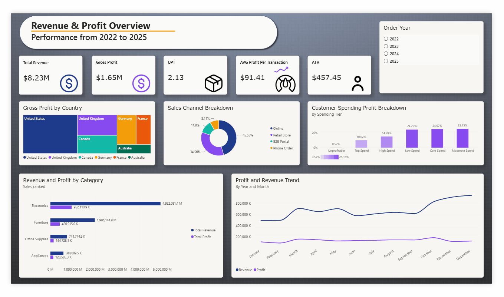

## Background and Business Questions

This analysis looks into a synthetic sales transaction dataset to uncover answers behind common yet practical business questions. In this project, my general process involves exploring the data briefly in Excel, cleaning said data using SQL, creating a visualization, and an evidence-backed report for my final suggestions moving forward.

### Business Questions

* Primary Question: Are we hitting our expected revenue/profit target?
* Which products/categories generate the highest profit?
* How are our total sales spread across our pricing tiers?
* What is our revenue trend over the past year (2025)? Profit? Where are the monthly inflection points?
  
---

## Key Outcomes

To stay on track while wearing both client and developer hats, I've settled on key project outcomes:

* Create polished deliverables (3): cleaned sales transactions script, sales transactions dashboard, findings report
* Improve listed key skills
* Build on business intelligence terminology and data extraction concepts

---

## Dashboard and Findings

<a href="/assets/sales-transactions-dashboard-2022-2025.zip" download="sales-transactions-dashboard-2022-2025.zip" class="button is-primary is-rounded">Download Report</a>

### Findings

Revenue and profit targets were decided based on a YoY (year-over-year) growth target. Every year
following year one has a target of the previous year's revenue/profit plus a 10% growth rate:

| Year | Previous Year's Revenue & Profit  | Target                                   |  
| ---- | --------------------------------  | ---------------------------------------  |
| 2022 | N/A                               | 95% of Year One's R/P: $1.91M,  $386.25K |
| 2023 | $2.01M,  $406.58K                 | $2.21M,  $447.24K                        |
| 2024 | $2.02M,  $401.26K                 | $2.22M,  $441.39K                        |
| 2025 | $1.9M,  $382.80K                  | $1.31M,  $421.08K                        |

Knowing this, **are we hitting our expected revenue/profit target?** Years 2022 and 2025 exceeded expectations while
the years of 2023 and 2024 underperformed. The margin between 2024's performance and target expectations is substantially larger than 2023's margin.
Notably, 2025's revenue and profit exceed the targets of both 2024 and 2023. There may be a change in operations that correlates to this.

| Year | Total Revenue & Gross Profit      | Target                                   | 
| ---- | --------------------------------  | ---------------------------------------- |
| 2022 | $2.01M,  $406.58K                 | $1.91M,  $386.25K                        |
| 2023 | $2.02M,  $401.26K                 | $2.21M,  $447.24K                        |
| 2024 | $1.9M,  $382.80K                  | $2.22M,  $441.39K                        |
| 2025 | $2.30,  $454.80K                  | $1.31M,  $421.08K                        |

**Electronics and furniture** consistently generate the most profit amongst the categories. Knowing this, we should consider:

* Further investigate customer demographics within these categories 
* Put more marketing focus on these drivers
* Add savings bundles with our lower profit category items (e.g., furniture & appliance discount bundles)

Pricing tiers are divided based on percentiles of the dataset's profit (10th, 25th, 50th, 75th and 90th respectively). Knowing this,
the majority of our customers are **moderate spenders**, historically spending between 70 to 197 dollars. I suggest further analyzing 
the products these customers purchase alongside their preferred sales channel. After finding these answers, we can increase the average 
transaction value gradually. This is through targeted advertising, discounting via associated item bundles, and or upgrade suggestions 
to their usual purchases.

Finally turning attention to our **revenue and profit trends during 2025**, The highest **revenue** was seen in December at $269,347.80 while the highest
**profit** was seen in October at $52,855.40. Notably despite December's high revenue, profit ($34,430.80) was considerably low compared to off-season months. I suggest investigating common culprits, weighing options, and reaching a compromise. After further investigation, consider reducing discount rates, seasonal staffing, ad spending, or low spend item focus based on findings.   

### Areas for Improvement and Reflection

As with any project endeavor, there are things I'd like to improve on and explore:

* More varied and targeted SQL queries (CTEs, Window functions, more optimized querying)
* More in-depth suggestions

---

## Key Skills Improved

 * Refining business questions
 * Extracting meaningful data
 * Cleaning data
 * Visualizing data
 * Creating data stories to inform decision making
